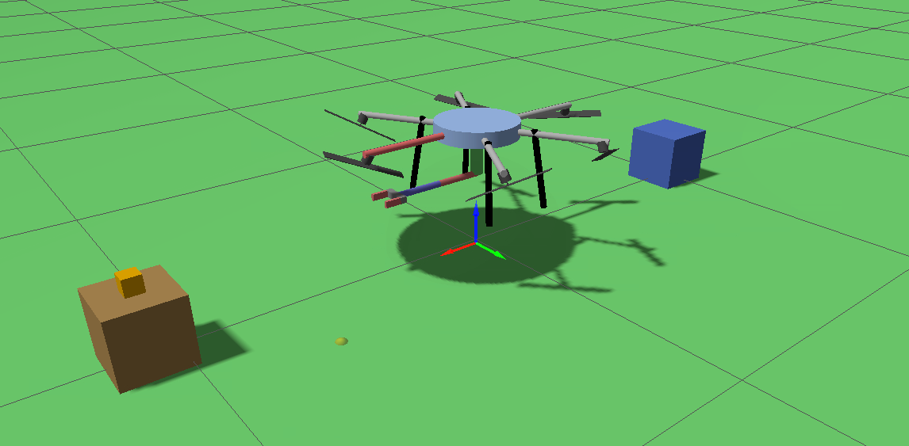
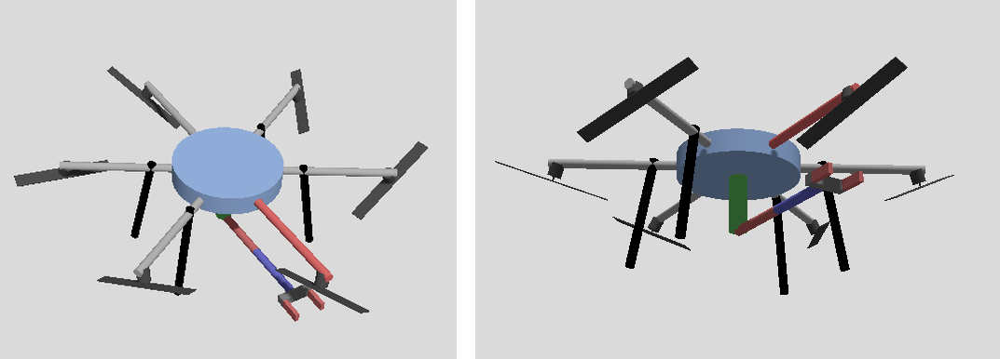
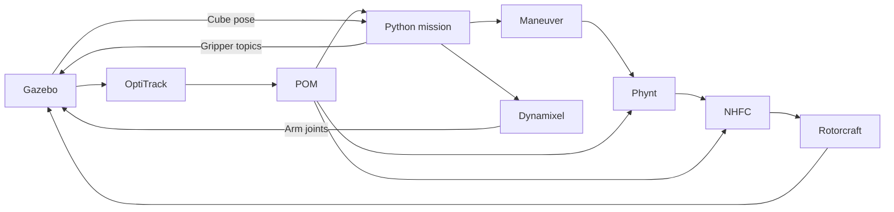

# Aerial Manipulation: Hexarotor Pick-and-Place

Code and report for a university group project developed at **Politecnico di
Milano** for the **Aerial Robotics** course, academic year 2025-2026.

The project coordinates a fully actuated hexarotor, a 3-DoF arm and a
two-finger gripper to pick a cube from one pedestal, carry it in flight and
place it on another in **Gazebo**, using the **TeleKyb3/GenoM3** framework.

**Authors:** Marco Bertazzoli Cova, Lorenzo Biasi and Marco Fiorini.  
**Professor:** Marco Tognon. **Lab tutor:** Gianluca Corsini.

[Read the project report](Report/Report_Aerial_Robotics.pdf) ·
[Run the simulation](#running-the-project) ·
[Reproducibility notes](docs/REPRODUCIBILITY.md)



## What we implemented

The project contribution is the mission and manipulation logic built around
the flight-control components supplied with the course framework:

- **A complete mission sequence:** take-off, approach, grasp, lift,
  transfer, placement, return and landing.
- **Online geometric inverse kinematics:** the arm target is updated from
  the measured cube pose and the estimated vehicle pose, with joint limits,
  filtered targets and limits on joint speed and acceleration.
- **Top-down grasping:** the drone performs coarse positioning while the
  arm handles the final alignment. Closing is triggered by a capture volume
  expressed in the gripper frame.
- **Grasp verification and recovery:** the cube height is checked after
  lifting; failed attempts can be retried with small target offsets.
- **Controlled placement:** the held cube is guided toward a release volume
  above the destination pedestal before the gripper opens.
- **Physical-interaction handling:** phase-dependent flight gains and
  trajectory limits are combined with the existing Phynt wrench observer
  and admittance filter.
- **Simulation models and diagnostics:** the repository includes the arm,
  gripper, rotor model and task world, plus mission logging and plotting tools.



## System architecture



The flight reference follows this chain:

```text
Maneuver -> Phynt -> NHFC -> Rotorcraft -> Gazebo
```

| Component | Role |
| --- | --- |
| Gazebo | Simulates the robot, contact dynamics, cube and pedestals |
| OptiTrack + POM | Provide simulated motion capture and vehicle-state estimation |
| Maneuver | Generates smooth reference trajectories |
| Phynt | Estimates external wrench and filters the reference through admittance |
| NHFC | Tracks the filtered reference and computes rotor commands |
| Rotorcraft | Connects the controller to the simulated vehicle |
| Dynamixel | Commands the three revolute arm joints |
| Gazebo joint-position topics | Command the two prismatic gripper joints |

The mission reads the cube pose directly from Gazebo. Although the vehicle
model is fully actuated, the flight controller uses `tilt_prioritized` mode
with position and yaw references; the project does not implement a separate
controller for tilt-free lateral flight.

## Reported results

The report evaluates ten simulation runs:

| Outcome | Successful runs |
| --- | ---: |
| Grasp on the first attempt | 5/10 |
| Successful grasp, including retries | 8/10 |
| Successful transfer | 7/10 |
| Successful placement | 6/10 |
| Complete mission | 6/10 |

These counts are taken from the submitted report. They have not been
re-measured for this repository update. The checked-in code and report have
some different tuning values, listed in the [reproducibility notes](docs/REPRODUCIBILITY.md).

The report also discusses vehicle tracking during picking and the Phynt
correction. Limitations include vertical tracking error, contact and grasp
sensitivity, the use of simulator-provided object poses and the small number
of trials. The project was evaluated in simulation.

## Repository layout

```text
Codici/
    control_new.py       Main mission implementation
    project.sh           Starts Gazebo and the GenoM components
    plot.py              Offline plots from generated component logs
    motion_arm.py        Separate ground-arm experiment
    control*.py          Earlier and alternative controller versions
    marco_files/         Earlier development variant
gazebo/
    worlds/project.world
    models/fah_arm/
    models/mrsim-rotor/
    models/ground_arm/
Report/
    Report_Aerial_Robotics.pdf
docs/
    REPRODUCIBILITY.md
    images/
requirements-plot.txt
```

Use **[Codici/control_new.py](Codici/control_new.py)** for the mission
described here. The other controller files preserve the project's development
history and use different strategies or parameters. In particular,
`control_clean.py` is an alternative implementation with different tuning
and does not load Phynt. See [Codici/README.md](Codici/README.md).

## Running the project

### Required environment

Run the simulation in the **Linux Docker environment supplied for the course**,
or an equivalent TeleKyb3/GenoM3 installation. The repository contains the
project-specific code and models; it does not include the course container,
a Dockerfile or the complete robotics software stack.

The environment must provide:

- Gazebo with `gz sim` and `gz topic`;
- GenoM3 with the `pocolibs` middleware, `h2`, `genomixd` and Python `genomix`;
- the `nhfc`, `phynt`, `maneuver`, `pom`, `optitrack`, `rotorcraft` and
  `dynamixel` components;
- the `mrsim-gazebo.so`, `dxsim-gazebo.so` and `optitrack-gazebo.so` plugins;
- the GenoM plugins under `$HOME/openrobots/lib/genom/pocolibs/plugins`,
  as expected by the main mission script.

The exact container image and software versions used for the original
experiments are not recorded in this repository. Installing the plotting
requirements alone does not install the simulation stack.

### Start the simulation

Inside the configured course environment, clone the repository to a short
path. The mission uses component log paths with a 64-character limit, so
avoid a deeply nested checkout directory.

```bash
git clone https://github.com/marcofiorinii/aerial-project.git ~/aerial-project
cd ~/aerial-project
sh Codici/project.sh
```

The launcher uses this checkout's world and model folders and starts the
required components. Keep this terminal open while running the mission.
The drone model is named `fahexa`; its simulated serial endpoints are
`/tmp/pty-fahexa` and `/tmp/pty-fahexa-arm`.

### Run the mission

Open a second terminal in the same configured container or environment:

```bash
cd ~/aerial-project
python3 Codici/control_new.py
```

Wait for the Gazebo world and GenoM components to be ready before launching
the script. Use a fresh world for each trial. To stop the stack, stop the
mission first, then press `Ctrl+C` in the launcher terminal.

Check the cube's final position to assess task success. The final console
message also marks completion of the return-and-landing sequence and does
not by itself establish that placement succeeded.

### Inspect the logs

The main mission writes logs to **`logs/last/`**. Starting another run
recreates this directory, so copy a run elsewhere before rerunning if you
want to keep it. Generated logs are ignored by Git.

For offline plotting, the Python dependencies are listed separately:

```bash
python3 -m pip install -r requirements-plot.txt
python3 Codici/plot.py
```

To inspect an archived run:

```bash
python3 Codici/plot.py --log-dir /path/to/archived-run
```

The plotting script expects `pom.log`, `maneuver.log`, `phynt.log` and
`rotorcraft.log` from the component logger. Raw logs from the ten reported
trials are not included. The supplied plotting script generates diagnostic
figures; it is not an exact reproduction script for every report figure.

## Credits

This work builds on the course-provided TeleKyb3/GenoM3 components and
Gazebo plugins. The low-level framework components are the work of their
original developers. The bundled `mrsim-rotor` model credits **LAAS/CNRS**;
existing model attribution has been retained. Simulation screenshots in this
README are reused from the project report, which contains the technical
references. The diagram above summarizes the connections in the mission code.
